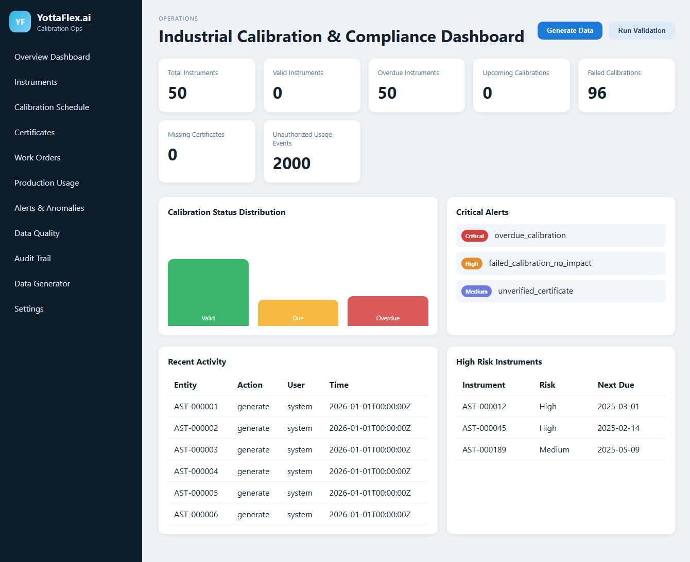

# YottaFlex.ai Industrial Calibration & Compliance Management Platform

YottaFlex.ai is a production-style industrial calibration and compliance workspace for manufacturing plants. It models real operational workflows for instrument lifecycle management, calibration scheduling, certificate tracking, work orders, production-use authorization, and audit-ready compliance monitoring.

## Demo preview



## Live deployment status

**Live demo:** [https://yottaflex.onrender.com](https://yottaflex.onrender.com)

The public dashboard is available at [https://yottaflex.onrender.com/dashboard](https://yottaflex.onrender.com/dashboard), and the dashboard API is at [https://yottaflex.onrender.com/api/dashboard](https://yottaflex.onrender.com/api/dashboard).

The service is deployed on Render's free plan. Free instances may spin down after inactivity, so the first request can take a little longer while the service starts.

## Features
- Instrument lifecycle management with immutable identifiers
- Calibration scheduling and due-date logic
- Pass/fail calibration evaluation using tolerance rules
- Certificate management and reconciliation checks
- Production-use authorization to prevent unauthorized overdue use
- Work-order and corrective-action tracking
- Alerting, anomaly detection, and audit trail capture
- Synthetic, seed-driven dataset generation for repeatable demos and testing
- Browser-based dashboard for operational monitoring

## Quick start

```bash
python -m venv .venv
. .venv\Scripts\activate
pip install -r requirements.txt
python main.py
```

Open http://localhost:5000

## Local demo workflow

1. Start the application:
   ```bash
   python main.py
   ```
2. Open the browser at http://localhost:5000
3. Use the dashboard or Data Generator page to generate the starter dataset
4. Review the calibration, alerts, quality, and audit sections

## CLI commands

```bash
python main.py --generate starter
python main.py --generate full
python main.py --validate
python main.py --reproducibility
python main.py --reset
```

## Validation and test coverage

The repository includes automated checks for business logic and reproducibility.

```bash
python -m pytest -q
```

Validated flows include:
- Due-date calculations
- Calibration event pass/fail evaluation
- Usage authorization decisions for overdue instruments
- Dataset count generation
- Reproducibility checks against a fixed seed
- Dashboard page load validation

## Common issues and fixes

- If the app cannot import the package, start the command from the repository root and ensure the virtual environment is active.
- If the dashboard is empty, run the generator from the UI or execute `python main.py --generate starter`.
- If reproducibility is inconsistent, ensure the same seed is used and avoid generating dataset files concurrently.
- If SQLite tables are stale, reset with `python main.py --reset` and regenerate the data.

## Project structure

- `yottaflex/` — core application logic, validation, and business rules
- `templates/` — Flask UI pages
- `static/` — CSS and JavaScript assets
- `data/` — SQLite database files
- `tests/` — smoke and business-logic tests
- `docs/assets/` — demo screenshots and GIF preview assets

## Business context

This platform simulates a realistic manufacturing environment where measurement instruments must stay within calibration validity windows to protect product quality, regulatory compliance, and operational continuity.
